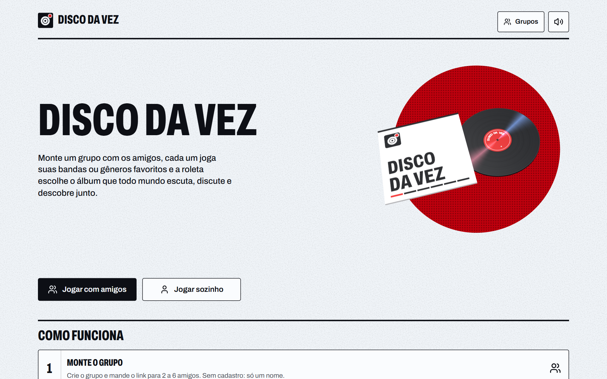
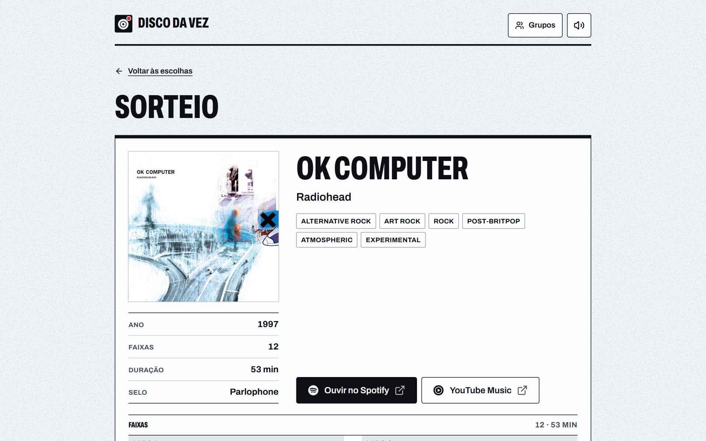

# Disco da Vez

> Chega de "o que a gente ouve hoje?". O grupo sorteia ou vota, e todo mundo ouve o mesmo álbum.

[](LICENSE)
[](https://react.dev)
[](https://www.typescriptlang.org)
[](https://vite.dev)
[](https://tailwindcss.com)
[](https://threejs.org)
[](https://supabase.com)
[](https://vitest.dev)
[](https://vercel.com)
[](https://musicbrainz.org)

<p align="center">
  
  
</p>

Disco da Vez é um ritual de escuta para grupos de 2 a 6 amigos. Cada pessoa joga até 5 artistas, gêneros ou álbuns; o grupo então gira uma roleta ou vota em segredo, e sai um álbum completo para todos ouvirem e comentarem depois. Sem cadastro: basta um nome e um link de convite.

## Como funciona

1. **Crie um grupo** e compartilhe o link de convite. Quem entra só informa um nome (login anônimo).
2. **O líder abre a rodada** e escolhe a forma de escolher (**artistas**, **gêneros** ou **álbuns**) e o tipo (**sorteio** ou **votação**).
3. **Cada pessoa escolhe de 1 a 5 itens** e confirma.
4. **O líder dispara**: a roleta sorteia um álbum, ou a votação mostra 6 candidatos e fecha quando todos votaram. Os votos são secretos até o fim e o desempate é feito no servidor.
5. **O álbum fica no histórico** do grupo ("Já ouvimos") e não volta a ser sorteado.

Também há o **modo solo** (`/solo`), que sorteia um álbum sem precisar de grupo.

## Recursos

- Sorteio com roleta animada e votação secreta, ambos em tempo real para todo o grupo.
- Capas, faixas e lados do vinil vindos do MusicBrainz e do Cover Art Archive; remasters são agrupados no mesmo álbum.
- Last.fm opcional como fonte extra de álbuns por gênero.
- Papéis claros: o líder inicia rodadas, remove pessoas, passa a liderança e exclui o grupo; se ele some por 7 dias, outro membro pode assumir. A lista completa está em [`PRODUCT.md`](PRODUCT.md).
- Avisos no celular (Web Push): com o sino ligado, cada etapa da rodada chega no telefone mesmo com o navegador fechado.
- Histórico por grupo, botões que abrem o álbum direto no Spotify e no YouTube Music, e cache local de 14 dias para as buscas.
- Pensado para celular (mobile-first), com toque e som opcional.

## Stack

| Camada | Tecnologia |
| --- | --- |
| Interface | React 19, Vite, TypeScript, Tailwind CSS 4, shadcn/ui, Motion, Three.js |
| Tempo real e dados | Supabase (Postgres, funções RPC, Realtime, login anônimo) |
| Álbuns | MusicBrainz, Cover Art Archive, iTunes (prévias), Odesli (links dos apps) e Last.fm (opcional) |
| Avisos | Web Push (service worker), Edge Function do Supabase, pg_net |
| Testes e lint | Vitest, oxlint |
| Hospedagem | Vercel (SPA estática, rewrite em `vercel.json`) |

## Começando

Você precisa de Node.js 20+ e de um projeto no [Supabase](https://supabase.com).

```bash
git clone https://github.com/fernandofilter/disco-da-vez.git
cd disco-da-vez
npm install
cp .env.example .env
```

### 1. Supabase

1. No **SQL Editor**, rode as migrações de `supabase/migrations/` em ordem: `0001_init.sql`, `0002_album_mode.sql`, `0003_delete_deal.sql`, `0004_fresh_choices.sql`, `0005_preview_leader.sql`, `0006_late_joiners.sql` e `0007_push.sql`. Se aparecer "Could not find the function … in the schema cache", falta rodar alguma delas.
2. Ative **Authentication → Providers → Anonymous sign-ins**.

### 2. Variáveis de ambiente

Preencha o `.env`:

| Variável | Obrigatória | Onde obter |
| --- | --- | --- |
| `VITE_SUPABASE_URL` | sim | Supabase → Project Settings → API |
| `VITE_SUPABASE_ANON_KEY` | sim | Supabase → Project Settings → API |
| `VITE_LASTFM_KEY` | não | [last.fm/api/account/create](https://www.last.fm/api/account/create) |
| `VITE_VAPID_PUBLIC_KEY` | não | `node scripts/make-vapid.mjs` (ver [Avisos no celular](#3-avisos-no-celular-opcional)); sem ela o sino não aparece |

### 3. Avisos no celular (opcional)

O sino do grupo inscreve o aparelho; a cada etapa da rodada um gatilho no banco chama a Edge Function `push` (pelo `pg_net`), que manda o aviso para quem ligou o sino, menos para quem fez a ação. Sem esta configuração tudo funciona igual, só sem avisos.

1. Gere as chaves: `node scripts/make-vapid.mjs`. Ponha `VITE_VAPID_PUBLIC_KEY` no `.env` (e na Vercel).
2. Publique a função com a [CLI do Supabase](https://supabase.com/docs/guides/cli), sem verificação de JWT (quem chama é o banco, com um segredo próprio):
   ```bash
   supabase secrets set VAPID_KEYS='<JSON gerado no passo 1>' PUSH_SECRET='<um segredo longo qualquer>'
   supabase functions deploy push --no-verify-jwt
   ```
   `VAPID_SUBJECT` (opcional) é o contato que os serviços de push veem; o padrão é `https://disco.fltr.com.br`.
3. No **SQL Editor**, guarde no Vault o endereço da função e o mesmo segredo:
   ```sql
   select vault.create_secret('https://<projeto>.supabase.co/functions/v1/push', 'push_url');
   select vault.create_secret('<o mesmo PUSH_SECRET>', 'push_secret');
   ```

No Android (Chrome) o aviso funciona direto do navegador. No iPhone (iOS 16.4+) só pelo app da Tela de Início: Compartilhar → "Adicionar à Tela de Início", abrir por lá e ligar o sino. O app da Tela de Início tem armazenamento próprio, então a pessoa entra no grupo de novo com o nome dela.

### 4. Rodar

```bash
npm run dev
```

A rota `/demo` (só em desenvolvimento) exercita o MusicBrainz e a roleta sem precisar do Supabase.

## Scripts

| Comando | O que faz |
| --- | --- |
| `npm run dev` | Servidor de desenvolvimento |
| `npm run build` | Checagem de tipos e build de produção em `dist/` |
| `npm run preview` | Serve o build localmente |
| `npm test` | Testes unitários (Vitest) |
| `npm run lint` | Lint com oxlint |
| `node scripts/smoke.mjs` | Teste de fumaça contra o Supabase real: percorre uma rodada de votação com duas sessões anônimas |
| `node scripts/member.mjs <grupo> <nome> [comandos]` | Membro simulado para testes manuais |
| `node scripts/make-vapid.mjs` | Gera as chaves VAPID dos avisos no celular |
| `node scripts/make-icons.mjs` | Gera `favicon.ico` e os PNGs a partir de `public/favicon.svg` |
| `node scripts/fetch-genres.mjs` | Atualiza `src/data/genres.json` com a lista de gêneros do MusicBrainz |

## Estrutura

```
src/
  pages/        Home, Solo, Group, History, Demo
  components/   Roleta, votação, escolha de itens, vinil 3D, capas, marca
  hooks/        Estado do grupo em tempo real
  lib/          API do Supabase, MusicBrainz, Last.fm, sorteio, cache
  data/         Lista de gêneros
supabase/
  migrations/   Esquema do banco e funções RPC
  functions/    Edge Function `push` (avisos no celular)
public/sw.js    Service worker que mostra os avisos
scripts/        Utilitários de teste e geração de ícones
```

## Ouvir no Spotify e no YouTube Music (regra fixa)

Os botões de ouvir (no álbum sorteado e no histórico) seguem uma regra que não muda, travada pelos testes de `src/lib/listen.test.ts`:

1. **Achou o álbum no app:** o botão abre direto a página do álbum. O link vem do MusicBrainz e, se ele não tiver, do [Odesli](https://odesli.co) a partir do álbum encontrado no iTunes.
2. **Não achou:** o botão abre a busca do app com o **título do álbum e o nome do artista** (`open.spotify.com/search/<título artista>` e `music.youtube.com/search?q=<título artista>`). Nunca um termo fixo, e nada depois do termo no caminho do Spotify: o antigo `…/search/<termo>/albums` fazia o app do Spotify buscar "albums" para qualquer disco.

Se uma mudança quebrar esses testes, quem está errada é a mudança. Detalhes em [`PRODUCT.md`](PRODUCT.md#listen-links-fixed-rule-do-not-change).

## Deploy

O projeto roda como SPA estática na Vercel. Configure as variáveis `VITE_*` no painel do projeto; o `vercel.json` já redireciona todas as rotas para o `index.html` (arquivos de `public/`, como `sw.js`, são servidos antes do redirecionamento).

## Documentação de design

- [`PRODUCT.md`](PRODUCT.md): público, propósito e princípios do produto.
- [`DESIGN.md`](DESIGN.md): sistema visual (tipografia, cores, componentes e comportamento).

## Licença

Distribuído sob a [licença Apache 2.0](LICENSE). © 2026 [FLTR Systems](https://fltr.com.br).
